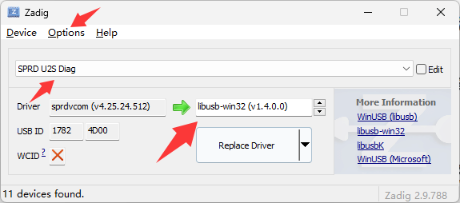

# SY108 (UDX710) 5G通信壳 OpenWrt 自定义移植与云端构建
本项目基于开源社区的 UDX710 主线适配方案，利用 GitHub Actions 自动化流水线，无需在本地配置复杂的 OpenWrt 编译环境，即可在云端一键编译出包含“不死固件”看门狗回退机制的 OpenWrt 固件与自定义 U-Boot。
## 核心准备工作：提取原厂数据 (必做)
在云端编译前，必须从你的物理设备中提取原厂分区数据。其中最关键的是 **splloader.bin** 和 **sml.bin**，它们是云端封装 U-Boot 引导程序的必需材料。此外，备份完整的原厂分区可以在设备变砖时救命。
### 1. 寻找底层刷机工具
你需要以下几个工具和文件，请自行搜索下载并放在 Windows 的同一个文件夹内：
- **基础工具**：[https://nightly.link/TomKing062/action_spd_dump_it/workflows/build/main](https://nightly.link/TomKing062/action_spd_dump_it/workflows/build/main)中下载，**233** 为旧版本，**249** 为新版本，根据系统版本选择 **X86** 或者 **X64** 后缀为 **Release** 的即可
- **配套文件**：在tool目录中的 **SY108** 文件夹中可直接下载配套的三个文件

### 2. 进入 FDL 刷机模式
- 设备完全断电，使用镊子短接主板上的刷机触点。
- 将 USB 线插入电脑，等待几秒后松开 RESET 键。
- 如果在设备管理器中看到 SPRD U2S Diag (COMx) 端口，说明驱动正常，设备已进入刷机模式。

### 3. 提取与备份原厂文件
- 打开 Windows 命令行（CMD），确保当前路径与你存放工具的文件夹一致。执行以下命令进入底层 FDL2 交互模式：
- ```spd_dump.exe --wait 300 exec_addr 0x3f28 fdl ./fdl1 0x28007000 fdl ./fdl2 0x9efffe00 exec```

### 3.1 如无法连接端口进入FD2模式则需要修改端口需要用到Zadig
- **Zadig 工具**：https://zadig.akeo.ie/#
- **Zadig使用教程**：Options --> List AII Devices 选中，在设备选中框中选中SPRD U2S Diag，Driver中查看当前驱动是否为sprdvcom，将其改为libusb-win32。


### 4. 提取与备份原厂文件
**警告：** 进入 `FDL2 >` 后，一条一条依次输入下面的命令，**每敲完一条等它跑到 100% 并出现 `Read Part Done` 后**，再敲下一条。

**1. 核心引导（保命用）**

```
read_part splloader 0 256k splloader.bin
read_part sml 0 256k sml.bin
read_part uboot 0 1M uboot.bin
```

**2. 系统内核（救砖用）**

```
read_part boot 0 12M boot.bin
read_part recovery 0 16M recovery.bin
```

**3. 基带与射频参数（保信号用）**

```
read_part nr_fixnv1 0 8M nr_fixnv1.bin
read_part nr_fixnv2 0 8M nr_fixnv2.bin
read_part prodnv 0 4M prodnv.bin
read_part nr_runtimenv1 0 10M nr_runtimenv1.bin
read_part nr_runtimenv2 0 10M nr_runtimenv2.bin
read_part persist 0 2M persist.bin
```

**4. 语音与状态（补全用）**

```
read_part nr_agdsp 0 6M nr_agdsp.bin
```

### 5. 将文件放入仓库

将刚刚提取出来的 **splloader.bin** 和 **sml.bin** 上传到本 GitHub 仓库的 `privates/` 文件夹中。请妥善在本地保存所有提取出来的文件，以防万一。

## 云端一键编译固件

本仓库集成了 GitHub Actions，你不需要在本地安装任何 OpenWrt 编译环境。

- 在本仓库页面，点击顶部的 Actions 标签。
    
- 在左侧列表点击 Build SY108 OpenWrt Firmware。
    
- 右侧点击 Run workflow。
    
- 你可以选择是否自动创建 GitHub Release 发布固件。如果勾选，编译成功后会自动发布到 Releases 页面供长期下载；如果不勾选，则只作为临时构建产物在 Actions 页面供下载。
    
- 点击绿色的 Run workflow 按钮。云端将自动执行拉取源码、编译内核、编译主系统、编译 Recovery、封装 U-Boot 等全套流程，约需 1 至 2 小时。
    
- 编译完成后，在 Actions 运行详情页底部下载 SY108-OpenWrt-Firmware 压缩包，或者在 Releases 页面下载。
    

## 刷入新固件

云端编译并解压后，你将获得 4 个文件：uboot.bin、sysupgrade.bin、boot.bin、recovery_boot.bin。

- 再次让设备按照前述步骤进入 FDL2 模式。
    
- 依次逐行输入以下刷写命令，将固件写入设备。
    

写入自定义 U-Boot：

text

w uboot uboot.bin

写入 OpenWrt 主系统：

text

w system sysupgrade.bin

写入恢复系统：

text

w recovery recovery_boot.bin

重启设备：

text

reset

注意：具体写入的分区名称，请根据原厂分区表确认。

## 免责声明

刷机有风险，本项目仅供技术交流与折腾，因操作不当导致的硬件损坏、数据丢失、设备变砖等后果需自行承担。
